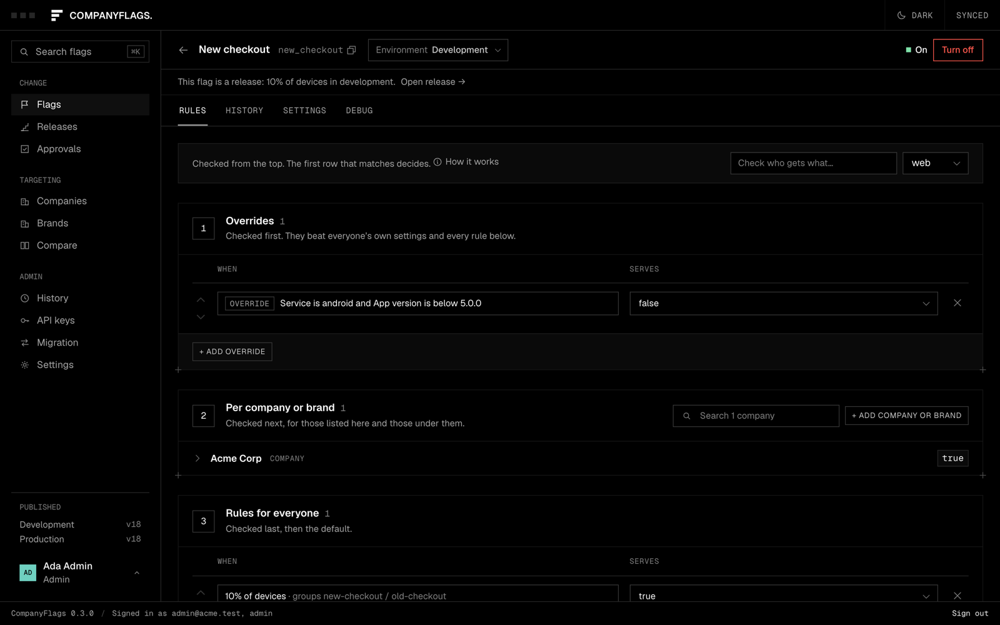
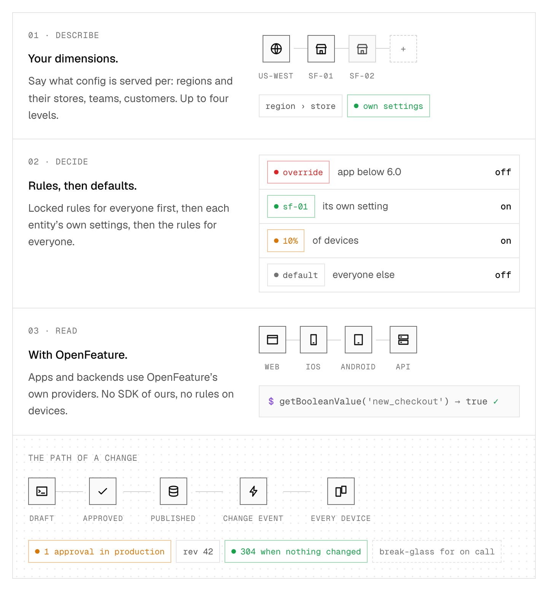

<p align="center">
  <picture>
    <source srcset=".github/assets/banner-dark.png" media="(prefers-color-scheme: dark)">
    <source srcset=".github/assets/banner-light.png" media="(prefers-color-scheme: light)">
    
  </picture>
</p>

<p align="center">
  <a href="https://github.com/dvir-daniel/companyflags/actions/workflows/ci.yml"></a>
  <a href="LICENSE.md"></a>
  <a href="https://openfeature.dev"></a>
  <a href="https://github.com/dvir-daniel/companyflags/stargazers"></a>
</p>

<p align="center">
  The most comprehensive feature flag framework: open source, self-hosted, and read with OpenFeature.
  <br>
  <a href="https://dvir-daniel.github.io/companyflags/"><strong>Learn more »</strong></a>
  <br>
  <br>
  <a href="https://dvir-daniel.github.io/companyflags/guide/quickstart">Quickstart</a>
  ·
  <a href="https://dvir-daniel.github.io/companyflags/">Docs</a>
  ·
  <a href="https://github.com/dvir-daniel/companyflags/issues">Issues</a>
  ·
  <a href="https://github.com/dvir-daniel/companyflags/discussions">Discussions</a>
</p>

## About the project

CompanyFlags is everything feature flags and remote config need, in one server you run yourself: rules and %
rollouts, releases, reviewed changes and a full history, settings for any part of your product, and OpenFeature for
every app and backend. Coming from another system? Run both side by side and move over one flag at a time.

<p align="center">
  
</p>

### Why CompanyFlags?

Feature flags start simple and grow. Some rules must hold for everyone, whatever else is set. Parts of your product
need settings of their own. Production changes need a second pair of eyes and a way back. Every app and backend should
get the same answer. CompanyFlags covers all of it in one place, and your code reads it through OpenFeature.

With AI writing more of the code, and AI features that change with a new model or prompt, this matters more: ship
what nobody read line by line behind a flag, to a few first, with a kill switch, and change models and prompts
without a deploy. See [Flags in the age of AI](https://dvir-daniel.github.io/companyflags/guide/ai).

- **Your own dimensions.** Serve config per `region` › `store`, per `team`, per `customer` › `brand`, or whatever
  your product is made of. You name the levels, up to four.
- **Settings per entity, rules for everyone.** Any region, store or customer can have settings of its own on any flag,
  inherited down the chain. Locked rules apply to everyone, always. The console traces every answer step by step.
- **OpenFeature, no SDK of ours.** Two OpenFeature standards: OFREP when the server decides, and flagd JSON when your
  app or backend decides itself (an app's file cached by your CDN). Your flag-reading code stays standard.
- **Nothing private reaches a device.** An app reads with its service's public key and gets values only: no rules,
  no lists of entities. A signed app link from your backend keeps it to its own entity's values.
- **Made for AI-written code and AI features.** AI-built changes ship off, then to a few, with a kill switch and a
  remove-by date; models, prompts and parameters are JSON flags you roll out per % or per customer, and roll back in
  seconds. Agents keep flags in `flags.json` with the code; turning one on in production still needs an approval.
- **Reviewed changes.** Production can require an approval for every change, with scheduling, break-glass for on
  call, an append-only history, restore, and side-by-side compare.
- **Releases and version releases.** Give early access to a few, then 1% → 5% → 25% → 50% of devices,
  then everyone, then clean it up; or move devices from version 1.0.0 to 1.0.1 the same way, with rollback.
- **Move over one flag at a time.** Run it next to the config system you have now: import its values (key-value
  JSON, flagd, or any shape through JSONata), apps read the old system for what hasn't moved, and webhooks out and in
  keep both the same until the last flag is here.
- **Your sign-in.** Email and password, Google, GitHub or Microsoft, and single sign-on with SAML or OIDC, through
  [Better Auth](https://www.better-auth.com).
- **Cheap at any scale.** Every entity's values are also one file your CDN caches, rebuilt once per publish, for
  fleets where no request should reach the server.
- **Plugins, one config file, a CLI.** Built the way Better Auth is: a small core, plugins for each way flags are read,
  one typed `companyflags.config.ts`, and a `companyflags` command that migrates and keeps your flags as code.

## Quickstart

```bash
docker run -d --name companyflags -p 8787:8787 -v companyflags:/data \
  -e BETTER_AUTH_SECRET="$(openssl rand -base64 32)" \
  -e BETTER_AUTH_URL=http://localhost:8787 \
  ghcr.io/dvir-daniel/companyflags
docker logs companyflags   # the setup link: make the admin account at http://localhost:8787/api/setup/…
```

Open the setup link the server prints and create the admin account: only that link can make it. The console then
walks you through four steps: environments, services (`web`, an app), your first flag (tick its services), and
connecting an app (**API keys**: make the `web` service's key). Dimensions are optional.

For production, run it with Postgres:

```bash
curl -O https://raw.githubusercontent.com/dvir-daniel/companyflags/main/docker-compose.yml
echo "BETTER_AUTH_SECRET=$(openssl rand -base64 32)" > .env
docker compose up -d
docker compose logs companyflags   # the setup link
```

Or from npm (Node.js 22.18+), in a folder of its own:

```bash
npx companyflags start   # embedded Postgres in ./data; prints the setup link
```

To keep a config file next to it, install it there: `npm i companyflags`, then `npx companyflags init`.

Or from source (Node.js 22.18+, pnpm 11):

```bash
git clone https://github.com/dvir-daniel/companyflags.git && cd companyflags
corepack enable && pnpm install
pnpm serve           # builds the console, serves it with the API on http://localhost:8787, prints the setup link
```

## Read flags with OpenFeature

Each app and backend reads a service: the flags you put in it. There are four ways, from two questions: is it an app
or a backend, and does the server decide (OFREP) or your code (flagd JSON)?

| | The server decides (OFREP) | Your code decides (flagd JSON) |
|---|---|---|
| **App** | OpenFeature's OFREP web, Android and iOS providers | The CDN file: the entity's flagd JSON, cached by your CDN |
| **Backend** | OpenFeature's OFREP server providers | flagd: the entity's rules, in memory |

Most apps start with OFREP. Make the service's key on the **API keys** page and give it to OpenFeature's own OFREP
provider. An app service's key is public, and reads values only:

```ts
import { OpenFeature } from '@openfeature/web-sdk';
import { OFREPWebProvider } from '@openfeature/ofrep-web-provider';

await OpenFeature.setContext({ targetingKey: installId, app: { version: '6.0.0' } });
await OpenFeature.setProviderAndWait(new OFREPWebProvider({
  baseUrl: 'https://flags.example.com',
  headers: [['Authorization', 'Bearer ff_prod_web_…']],   // the web service's key
}));

OpenFeature.getClient().getBooleanValue('new_checkout', false);
```

A backend service's key is secret, and a browser can't use one. A backend names the entity by its dimension, as the
rules do:

```ts
const limit = await client.getNumberValue('max_upload_mb', 100, { company: 'acme', targetingKey: userId });
```

Or it runs [flagd](https://flagd.dev) next to it, which downloads the entity's rules as flagd JSON, and evaluates every
flag in memory. To pin an app to its own entity, a backend can hand it a signed app link at sign-in
(`GET /sdk/v1/links/<dimension>/<entity>?service=web`): a token for OFREP, or the address of its CDN file. See
[Reading flags](https://dvir-daniel.github.io/companyflags/reading/overview) and
[Services](https://dvir-daniel.github.io/companyflags/guide/services).

## Examples

Small, working apps in [`examples/`](examples), each with a README. [`examples/seed.ts`](examples/seed.ts) sets up a
new server for them through the console's API, with an admin's access token, and prints the keys.

| | |
|---|---|
| [React](examples/react) | A Vite + React page: OpenFeature's React SDK and the OFREP web provider |
| [Node](examples/node) | A Node HTTP server: OpenFeature's server SDK and the OFREP provider, per company |
| [flagd](examples/flagd) | Docker Compose: CompanyFlags, and flagd syncing a company's flagd JSON |

## Configure it

Everything is optional: without a file, environment variables decide. With one, it's typed, like Better Auth's
`auth.ts`:

```ts
// companyflags.config.ts (companyflags init writes one)
import { defineConfig } from 'companyflags/config';
import { cdnFiles, cloudflare, flagd, ofrep, webhooks } from 'companyflags/plugins';

export default defineConfig({
  database: { url: process.env.DATABASE_URL },
  auth: { baseURL: 'https://flags.example.com' },
  plugins: [
    ofrep(),
    flagd(),
    cdnFiles(),
    cloudflare(),      // the zone and token from CF_ZONE_ID and CF_API_TOKEN
    webhooks(),
  ],
});
```

The file goes in a folder where `companyflags/config` resolves: one where you ran `npm i companyflags`, the clone's
root, or `/app` in the Docker image.

Keep the flags your code reads in a file next to it, and push it from CI:

```bash
companyflags flags plan     # what would change
companyflags flags push     # new flags, details, variants, services; reviewed where production needs it
```

See [Plugins](https://dvir-daniel.github.io/companyflags/reference/plugins),
[CLI](https://dvir-daniel.github.io/companyflags/reference/cli) and
[Architecture](https://dvir-daniel.github.io/companyflags/guide/architecture).

## How it works

<p align="center">
  <picture>
    <source srcset=".github/assets/how-it-works-dark.png" media="(prefers-color-scheme: dark)">
    <source srcset=".github/assets/how-it-works-light.png" media="(prefers-color-scheme: light)">
    
  </picture>
</p>

One evaluator decides every answer: OFREP's, the CDN files', the backends' flagd JSON and the console's trace. The
tests check each against it, with OpenFeature's own providers and flagd's own logic, for many entities and devices
(hundreds of tests, on embedded and real Postgres). Several server instances can share one Postgres database.

## Documentation

| | |
|---|---|
| [Introduction](https://dvir-daniel.github.io/companyflags/guide/introduction) | What it is, who it's for, what it doesn't do yet |
| [Concepts](https://dvir-daniel.github.io/companyflags/guide/concepts) | Environments, services, dimensions, flags, rules |
| [Reading flags](https://dvir-daniel.github.io/companyflags/reading/overview) | OFREP and flagd JSON, in apps and backends |
| [Migration](https://dvir-daniel.github.io/companyflags/guide/migration) | Moving from another system, import, export, webhooks |
| [Self-hosting](https://dvir-daniel.github.io/companyflags/self-hosting/docker) | Docker, configuration, sign-in, CDN, production |
| [AI resources](https://dvir-daniel.github.io/companyflags/guide/ai-resources) | `llms.txt`, a skill for your agents, and OpenFeature's MCP server |
| [Plugins](https://dvir-daniel.github.io/companyflags/reference/plugins) and [CLI](https://dvir-daniel.github.io/companyflags/reference/cli) | The built-in plugins, writing your own, and the `companyflags` command |
| [HTTP API](https://dvir-daniel.github.io/companyflags/reference/http-api) | Keys, OFREP, CDN files, flagd JSON, links, health |

The docs are in [`docs/`](docs) and run locally with `pnpm docs:dev`.

## Status

CompanyFlags is before 1.0: tested and usable, but young, and the console's own API may change. Not built yet:
experiment statistics, your own attributes beyond the built-in list, sending email (invite and password reset links
are sent by hand), SCIM provisioning, and secret values (don't put secrets in flags). See
[the introduction](https://dvir-daniel.github.io/companyflags/guide/introduction#what-it-doesn-t-do-yet).

## Contributing

Issues and pull requests are welcome. [CONTRIBUTING.md](CONTRIBUTING.md) explains how to set up (`pnpm dev`), how the
code is organised and what we check (`pnpm check`). Please read the [code of conduct](CODE_OF_CONDUCT.md).

## Security

Please report vulnerabilities privately, as described in [SECURITY.md](SECURITY.md). Never in a public issue.

## License

[MIT](LICENSE.md)
